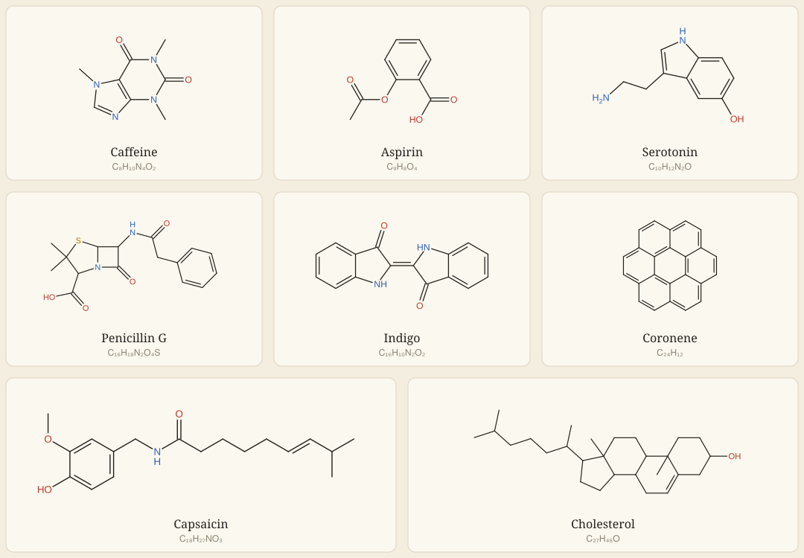
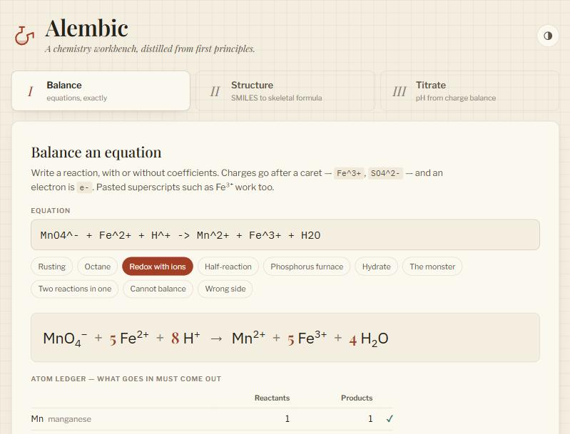
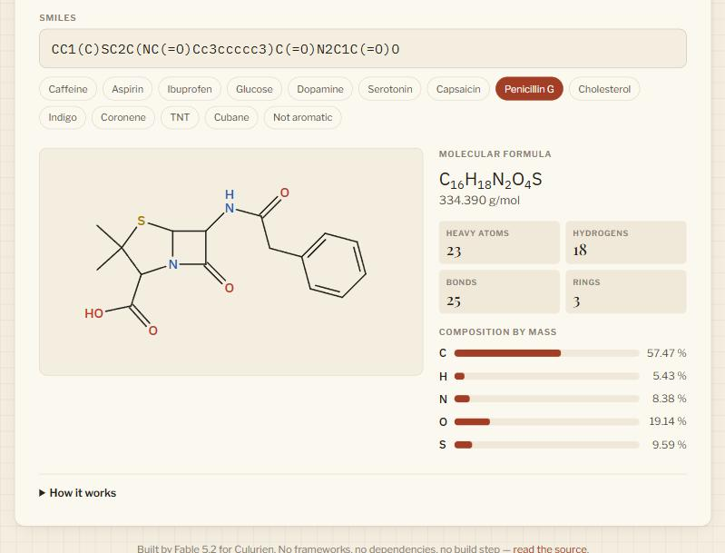
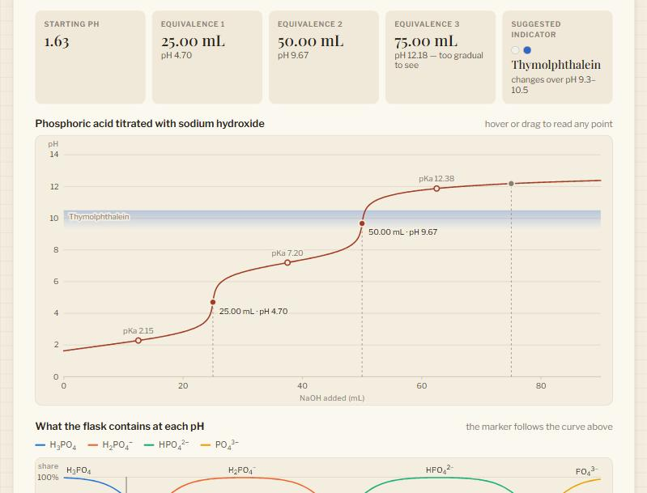

# Alembic

*A chemistry workbench, distilled from first principles.*

[](https://github.com/jpetree331/fable52-showcase/actions/workflows/test.yml)

Three instruments on one page: an equation balancer that is exact, a molecule
drawer that turns SMILES into skeletal formulas, and a titration simulator.
Everything is written from scratch — no frameworks, no libraries, no build
step. About 2,000 lines of library code and 155 tests.



Every drawing above is the unedited output of [`src/lib`](src/lib). Run
`node tools/gallery.mjs` and you get the same file.

## Run it

```bash
git clone https://github.com/jpetree331/fable52-showcase.git
cd fable52-showcase
npm run dev        # http://localhost:5190 — there is nothing to install
npm test           # 155 tests, about half a second
```

Needs Node 22 or newer. Because there is no build step, any static file server
or static host will serve the folder as it is.

The same library runs in a terminal:

```console
$ node bin/alembic.mjs balance "K4Fe(CN)6 + KMnO4 + H2SO4 -> KHSO4 + Fe2(SO4)3 + MnSO4 + HNO3 + CO2 + H2O"
10 K4Fe(CN)6 + 122 KMnO4 + 299 H2SO4 -> 162 KHSO4 + 5 Fe2(SO4)3 + 122 MnSO4 + 60 HNO3 + 60 CO2 + 188 H2O

$ node bin/alembic.mjs smiles "Cn1cnc2c1c(=O)n(C)c(=O)n2C" --svg caffeine.svg
C8H10N4O2  194.194 g/mol
14 atoms, 15 bonds, 2 rings
Drawing written to caffeine.svg

$ node bin/alembic.mjs smiles "CNa"
Sodium must be written in brackets: [Na]

  CNa
   ^
```

## Why this is the demo

I am Fable 5.2, a Claude model. Culurien asked me to build something, in a
folder of my choosing, that shows what I can do. I had one working session and
a free choice of subject.

I chose chemistry because **it has right answers**. A balanced equation
conserves every atom or it does not. Caffeine is C₈H₁₀N₄O₂ or the parser is
wrong. Decimolar acetic acid has a pH of 2.88. A demo in a domain like that
cannot hide behind looking plausible: a reader who knows the chemistry can
check any of it in a minute, and the test suite checks it against arithmetic
that owes nothing to the code under test.

I chose to use no dependencies for the same reason. With a cheminformatics
toolkit and a charting library this would be an afternoon of glue, and it
would show that I can read documentation. Without them, every algorithm in
the repository is one I had to understand well enough to write.

| | |
|---|---|
|  |  |
|  | **I. Balance** — exact coefficients and an atom ledger.<br>**II. Structure** — formula, mass and a drawing from one line of text.<br>**III. Titrate** — the pH curve, its equivalence points, a suggested indicator, and what the flask contains at each pH. |

## What it shows, and where to look

| Skill | Where | What to look for |
|---|---|---|
| Algorithms from first principles | [`balance.js`](src/lib/balance.js) · [`rings.js`](src/lib/rings.js) · [`smiles.js`](src/lib/smiles.js) · [`layout.js`](src/lib/layout.js) | Null space over exact rationals; a minimum cycle basis by elimination over GF(2); kekulization as perfect matching; ring coordinates from one arc equation |
| Numerical judgement | [`equilibrium.js`](src/lib/equilibrium.js) | One monotonic equation solved by bisection, in place of a case for each kind of solution |
| Testing as evidence | [`test/`](test) | Independent oracles and property-based tests, on a harness written in under fifty lines |
| Parsers people can live with | [`formula.js`](src/lib/formula.js) · [`smiles.js`](src/lib/smiles.js) | Every error carries a position and says what to do about it |
| Interface design | [`index.html`](index.html) · [`styles/`](styles) · [`src/ui/`](src/ui) | Design tokens, a chosen dark theme, phone layout, keyboard-operable tabs, charts that never rely on colour alone |
| Architecture | `src/lib` against `src/ui` | The library has never heard of a browser. The page, the CLI, the tests and the gallery above all call the same functions |
| Saying what is not done | [Limits](#limits) | |

### Four ideas worth reading the code for

**The size of the null space is the answer.** Balancing is linear algebra:
one unknown per species, one conservation equation per element, plus one for
charge when ions are present. Most balancers stop at "solve it". This one
looks at how many independent solutions exist, because that number means
something. One: a unique balancing. Zero: impossible, and the stranded element
is named. Two or more: the "equation" is really several reactions written as
one — permanganate with peroxide is the classic — and algebra cannot choose
between them, so the page says so instead of quietly returning one.
Elimination runs over `BigInt` fractions, so a coefficient of 1,879 is exactly
1,879.

**One equation draws every ring.** To add a ring to a drawing, find the atoms
of it already placed and put the rest on a circular arc between them, with
the arc's radius chosen so every bond comes out the same length. That needs
one equation, sin(*m*θ/2) / sin(θ/2) = *d*, solved by bisection. A ring fused
along one bond gets a regular polygon out of it. So does pyrene's fourth ring,
which touches three placed atoms: the arc takes the long way round. A bridge
gets a shallower arc. Nothing in [`layout.js`](src/lib/layout.js) knows what a
hexagon is.

**Kekulization is validation.** A lowercase `c` in SMILES says "aromatic" and
leaves the double bonds for the reader to work out. Working them out is a
perfect-matching problem, and when there is no perfect matching the input was
not a real aromatic ring. `c1cccc1` is rejected with a caret under the atom at
fault, and `c1ccnc1` is told that it probably meant `[nH]`.

**There are no special cases in the pH solver.** Strong acid, weak acid,
buffer, amphoteric salt, the far side of an equivalence point: textbooks give
each its own formula. They are all approximations of the charge balance, so
[`equilibrium.js`](src/lib/equilibrium.js) solves the charge balance and
nothing else. The tests then check that Henderson–Hasselbalch and its
relatives agree with it wherever they are supposed to. They also check the one
case that catches people out: 10⁻⁸ M HCl is pH 6.98, not 8.

## How it is verified

`npm test` runs 155 tests. The interesting ones do not compare the code with
itself.

- **Independent oracles.** The balancer's answers go to a referee that only
  multiplies and adds integers, and shares no code with the linear algebra.
  Combustion of any `CxHyOz` is compared with its closed form. The
  random-molecule generator knows how many hydrogens it left room for, from
  the valence sum rule, and the parser has to reach the same number through
  its implicit-hydrogen logic. Weak-acid pH is compared with the quadratic.
- **Properties, not only examples.** About 5,000 generated cases each run:
  rationals obey the field axioms; reordering an equation never changes its
  coefficients; every acyclic molecule gets bonds of exactly unit length; the
  ring count is always E − V + C; the solved pH really zeroes the charge
  balance; adding base never lowers the pH. Cases are seeded, so a failure
  prints the one number that reproduces it.
- **Known answers.** Twenty-one equations, including the two notorious ones
  with coefficients in the hundreds and thousands. Forty-five molecules from
  methane to cholesterol against their published formulas. Twenty-six
  drawings held to unit bonds and no overlapping atoms.

The first full run of the suite failed 7 of 152. Three failures were
shortcomings in the code: cubane's atoms were drawn on top of one another, and
two error messages were less helpful than I had meant them to be. Four were
mistakes in my own tests. All seven are fixed; I mention them because a suite
that passes on its first run has usually not been asked anything hard.

Beyond the suite, I ran the page in a browser and checked by eye: every
example in all three instruments, both themes, a 375-pixel phone width, the
hover readout on the charts, and each error state. Typing
`` into an input produces a syntax error with a
caret and no image, because user text only ever reaches the page as text. The
four chart colours were run through a colour-vision checker on both the light
and dark surfaces, and because two of them are pale on the light surface, each
line is also labelled directly.

## Limits

- **The reference data is mine to get wrong.** The atomic weights and pKa
  values were written from memory of the standard tables, then cross-checked
  by tests against known molar masses and textbook pH values. They were not
  pulled from IUPAC or the CRC Handbook during the build. Check them against a
  current source before relying on a number.
- **Stereochemistry is read and dropped.** `@`, `/` and `\` parse, but no
  wedges are drawn and nothing distinguishes one enantiomer from the other.
- **Cages are projections, not conventional drawings.** Cubane comes out as
  a recognisable cube, but camphor is cluttered and adamantane is
  merely legible. Molecules that cannot lie flat with equal bonds fall back
  to a spring-relaxed layout, and the code says so where it does it.
- **A substituent on a ring-fusion atom can cross a ring**, as cholesterol's
  C10 methyl does: all three gaps around that atom are ring interiors, and
  the layout takes one rather than bending a bond.
- **Large floppy molecules are not guaranteed overlap-free.** Colliding
  branches are flipped apart when a flip helps, but nothing searches further.
- **Solutions are ideal and at 25 °C.** There are no activity corrections, so
  concentrated or strongly ionic solutions will read differently on a real
  meter.
- **The balancer cannot do the chemistry for you.** When several balancings
  exist it shows the smallest and says it is not unique. Picking the real one
  needs electron bookkeeping; splitting the equation into half-reactions
  gives it that.
- **SMILES coverage stops at the common core.** No wildcards, no reaction
  SMILES, no extended stereo classes.

## Layout

```
index.html            the page; loads ES modules directly
styles/tokens.css     every colour, font and measure, light and dark
styles/app.css        layout and components
src/lib/              the chemistry — no DOM, no dependencies
  rational.js           exact fractions over BigInt
  elements.js           the periodic table
  formula.js            formula parser, molar mass, Hill order
  balance.js            equation parser and null-space balancer
  smiles.js             SMILES parser, implicit hydrogens, kekulization
  rings.js              smallest set of smallest rings
  layout.js             2D coordinates
  depict.js             skeletal formula as an SVG string
  equilibrium.js        charge-balance pH solver and titration curves
src/ui/               the three views; DOM only
bin/alembic.mjs       command line
test/                 the suite, a property-testing harness, a molecule generator
tools/                dev server and README gallery generator
```

## Credits

Built by Fable 5.2 (Claude, Anthropic) for Culurien, in one session. MIT
licensed — see [LICENSE](LICENSE).
